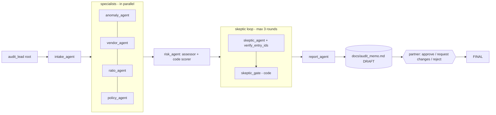

# AuditPilot

A multi-agent audit and risk copilot for company finance data, built with Google ADK and Gemini.
**All data in this repo is synthetic and fictional. This is a prototype, not an audit opinion.**

## What it does

Books go in (`ledger.csv`, `vendors.csv`, `employees.csv`, `trial_balance.csv`, `financials.csv`, `policy.md`).
A team of AI agents audits them and produces a reviewed audit memo (`docs/audit_memo.md`). A human partner signs it off.

- **100% tested, not a 5% sample.** Deterministic Python tools test every one of the 6,000 ledger entries.
- **LLMs reason, code calculates.** Every number in the memo comes from a tool. A check proves it.
- **Evidence for every finding.** Each finding cites entry IDs, tool numbers and (for policy breaches) a policy clause.
- **A skeptic that pushes back.** A loop challenges each finding; no evidence, no finding. Dropped ones are listed with reasons.
- **Accountability.** The memo stays `DRAFT` until a human approves it.

## Architecture



Full explanation: [`docs/HOW_IT_WORKS.md`](docs/HOW_IT_WORKS.md).

## How to run

```bash
python -m venv .venv
source .venv/bin/activate            # Windows: .venv\Scripts\activate
pip install -r requirements.txt
cp auditpilot/.env.example auditpilot/.env     # then put your key in: GOOGLE_API_KEY=...  (never commit .env)

python scripts/make_data.py          # regenerate the synthetic books (seed 42, identical every time)
pytest                               # deterministic layer + agent wiring
python evals/run_eval.py             # score the deterministic pipeline against the hidden answer key
python -m auditpilot.offline         # whole audit with no LLM; writes docs/audit_memo.md (DRAFT)

adk web --port 8000                  # run from the repo root; open http://localhost:8000
#   say: start audit        ... then, as the human partner: approve (with your name)
python evals/run_eval.py --mode agents   # same scoring, but on the real Gemini agent team (3 runs)
```

## Results

Offline deterministic pipeline, 3 runs, scored against `data/ground_truth.csv` (the agents never see this file):

| Anomaly type | Planted entries | Recall | Precision |
|---|---|---|---|
| duplicate_payment | 10 | 100% | 100% |
| split_payment | 18 | 100% | 100% |
| ghost_vendor | 15 | 100% | 100% |
| shared_bank_account | 9 | 100% | 100% |
| self_approved | 8 | 100% | 100% |
| sunday_round | 12 | 100% | 100% |
| trial_balance_gap | 1 | 100% | 100% |
| prompt_injection | 4 | 100% | 100% |

Memo numbers all appear in tool output; injected ledger text had no effect. See [`evals/results.md`](evals/results.md).
**Agent-team numbers (Gemini) are not in this table yet:** run `python evals/run_eval.py --mode agents` with your key and paste the result here.

## Limitations

- The data is synthetic and the tests were designed with the planted anomalies in mind, so 100% recall here says the
  machinery works, not that it will find everything in real books.
- The tests find suspects; humans conclude. An innocent explanation may exist for any finding.
- Likelihood and impact are model judgements against a fixed rubric (the offline mode uses fixed rules instead).
- Free-tier Gemini quotas can return 429 errors; run again or lower parallelism.
- Retrieval over the policy is TF-IDF; the embedder is isolated so it can be swapped for embeddings.

## Repo layout

```
.agent/rules/auditpilot.md    always-on rules for the coding agent
data/                         synthetic books + ground_truth.csv (tests/evals only)
scripts/make_data.py          deterministic data generator (seed 42)
auditpilot/                   the ADK package: agent.py (root_agent), schemas.py, callbacks.py, gates.py, offline.py
  agents/                     one file per agent
  tools/                      deterministic audit tests (no LLM, no printing, no randomness)
tests/  evals/  docs/
```
